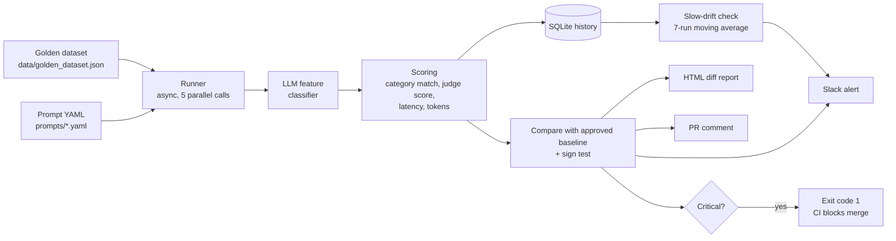

# LLM Regression Detector

**CI/CD for AI behaviour.** Every time a prompt or model changes, this pipeline re-tests an LLM-powered feature against a hand-labelled "golden" dataset, compares the result with the last approved version, and alerts the team or blocks the merge before a quality drop reaches users.

  

> **Demo feature under test:** a customer-support email classifier that returns a category (`billing`, `technical`, `account`, `general`) and a one-sentence summary. The pipeline itself is feature-agnostic: swap the classifier and the dataset and it tests any LLM output.

<!-- ADD YOUR SCREENSHOTS HERE, e.g.


-->

---

## Table of contents
1. [The problem](#the-problem)
2. [The solution](#the-solution)
3. [Real-world use cases](#real-world-use-cases)
4. [How it works](#how-it-works)
5. [Quick start](#quick-start)
6. [Usage](#usage)
7. [The golden dataset](#the-golden-dataset)
8. [Scoring and regression logic](#scoring-and-regression-logic)
9. [CI/CD integration](#cicd-integration)
10. [Configuration](#configuration)
11. [Project structure](#project-structure)
12. [Design decisions](#design-decisions)
13. [Limitations](#limitations)

---

## The problem

### The technical problem: AI fails silently
Traditional software fails loudly: an exception, a failed unit test, a red build. LLM features do not. When someone edits a prompt or upgrades a model, the feature keeps returning well-formed, confident-looking answers that are *slightly worse*. There is no stack trace for "the model now labels refund requests as general enquiries".

Common causes of silent regressions:
- A prompt edit that fixes one case and quietly breaks others.
- A model version upgrade or provider-side update that changes behaviour.
- A temperature or parameter tweak.
- Edits to few-shot examples.

Teams usually check a handful of examples by hand, see that they look fine, and ship. That is shipping blind.

### The business problem: bad AI output costs real money
When an AI feature degrades unnoticed, the damage shows up downstream:
- **Customer experience:** tickets routed to the wrong team wait days; customers repeat themselves; complaints rise.
- **Operational cost:** staff manually re-route or redo work the AI was meant to automate.
- **Revenue and risk:** wrong answers in billing, compliance or healthcare workflows create refunds, churn and regulatory exposure.
- **Slow iteration:** teams become afraid to improve prompts or adopt cheaper models because they cannot prove nothing broke.

The cost is usually discovered days or weeks later, from customers instead of from a test.

## The solution

This project treats **prompts as code** and **model behaviour as something you test on every change**:

1. Prompts live in versioned YAML files under `prompts/`.
2. A **golden dataset** of human-labelled cases defines what "correct" means.
3. On every pull request that touches `prompts/`, GitHub Actions runs the dataset through the feature.
4. Results are scored on several dimensions and **diffed against an approved baseline**.
5. The system produces an HTML diff report, posts a PR comment, sends a Slack alert, and returns a non-zero exit code on a critical regression so the merge is blocked.
6. A separate **slow-drift detector** watches the moving average across runs to catch gradual decay that no single run reveals.

Outcome: a prompt change cannot reach users without evidence that it did not make things worse.

## Real-world use cases

| Domain | What the AI does | What this pipeline protects |
|---|---|---|
| Customer support (banks, telecoms, retailers) | Routes and summarises incoming tickets | Wrong-team routing, missed urgent complaints |
| Insurance and claims | Triages claim documents and emails | Misclassified claims, SLA breaches |
| IT and HR service desks | Sorts requests and suggests answers | Misrouted incidents, wrong self-service answers |
| Content moderation | Labels user content | Drift in what gets flagged or allowed |
| Data extraction | Pulls fields from invoices or contracts | Silent drops in extraction accuracy |
| Model migration | Moves from one model/provider to another, often to cut cost | Proof that the cheaper model is "good enough" before switching |

**Typical business scenarios**
- *"Can we switch to a cheaper model?"* Run the golden dataset on both and compare accuracy, latency and token usage with evidence rather than opinion.
- *"Is the new prompt actually better?"* The diff report lists exactly which cases improved and which regressed.
- *"Did the provider change something under us?"* Scheduled runs plus drift detection surface behaviour changes you did not cause.
- *"What do we tell auditors or leadership?"* Every change has a recorded evaluation: prompt version, model, dataset version, scores, and who approved the baseline.

## How it works



**Flow of one run**
1. Load a versioned prompt and the golden dataset (cases must have unique IDs).
2. Send each email to the model with the prompt (async, limited concurrency).
3. Validate the model's JSON with Pydantic; invalid output counts as a failed case.
4. Score each case, store everything per case.
5. Compare with the baseline: pass-rate delta, per-category deltas, cases that flipped pass-to-fail (regressions) and fail-to-pass (improvements), plus a significance check.
6. Check the rolling average for slow drift.
7. Write the report, notify, and set the exit code.

## Quick start

**Requirements:** Python 3.11+. An OpenAI API key is optional; a free built-in mock provider lets you try everything without one.

```bash
git clone https://github.com/<your-username>/llm-regression-detector.git
cd llm-regression-detector

python -m venv .venv
# Windows:  .venv\Scripts\activate
# Mac/Linux: source .venv/bin/activate

pip install -r requirements.txt

# Free run with the mock provider (no API key needed)
python -m regdet run --prompt prompts/v1.yaml --provider mock --no-slack

# Run the unit tests
python -m pytest -q
```

Open the generated `reports/report_*.html` in a browser.

> **Mock provider:** a keyword-based fake LLM used for learning and for CI without secrets. Its scores demonstrate the pipeline; they are **not** a measure of real model quality.

**Using a real model**
```bash
cp .env.example .env        # Windows: copy .env.example .env
# edit .env:
#   PROVIDER=openai
#   OPENAI_API_KEY=sk-...
python -m regdet run --prompt prompts/v1.yaml --no-slack
python -m regdet promote reports/latest.json    # approve as the new baseline
```

**Free providers (no OpenAI account needed)**

Any OpenAI-compatible service works; set a base URL and a rate limit in `.env`. Free tiers change often, so check each service's current limits and model names in its console.

```
# Example: Groq (free, no card). Model names go in prompts/*.yaml (model:) and JUDGE_MODEL.
PROVIDER=openai
OPENAI_API_KEY=your-groq-key
OPENAI_BASE_URL=https://api.groq.com/openai/v1
REQUESTS_PER_MINUTE=20
JUDGE_MODEL=openai/gpt-oss-120b
# prompts/v1.yaml:  model: openai/gpt-oss-20b

# Example: Google Gemini (AI Studio key; OpenAI-compatible endpoint)
# OPENAI_BASE_URL=https://generativelanguage.googleapis.com/v1beta/openai/
# REQUESTS_PER_MINUTE=9
# USE_JUDGE=false          # saves half the requests on small free quotas
# JUDGE_MODEL / model:     gemini-3.5-flash-lite
```
`REQUESTS_PER_MINUTE` spaces requests out so the free limit is never exceeded (a full run of N cases makes N classify calls plus N judge calls). In CI, add `OPENAI_BASE_URL` as a repository secret and `REQUESTS_PER_MINUTE` / `JUDGE_MODEL` as repository variables.

## Usage

```bash
# Evaluate a prompt against the approved baseline (what CI does)
python -m regdet run --prompt prompts/v2.yaml --baseline baselines/baseline.json

# Evaluate against the previous local run instead
python -m regdet run --prompt prompts/v2.yaml

# Cheap smoke test on the first 5 cases
python -m regdet run --prompt prompts/v2.yaml --limit 5

# Approve a reviewed run as the new baseline
python -m regdet promote reports/latest.json
```

| Option | Meaning |
|---|---|
| `--prompt` | Path to the prompt YAML to test (required) |
| `--provider` | `mock` or `openai` (default from `PROVIDER`, else `mock`) |
| `--baseline` | Baseline JSON to compare against (default: previous local run) |
| `--dataset` | Golden dataset path (default `data/golden_dataset.json`) |
| `--limit N` | Only run the first N cases |
| `--no-slack` | Do not send the Slack message |
| `--out`, `--db` | Report folder and SQLite history path |

**Exit codes:** `0` pass or warning, `1` critical regression (CI fails), `2` configuration error (missing key, provider mismatch, bad file).

**Prompt file format** (`prompts/v1.yaml`)
```yaml
version: v1
timestamp: "2026-11-04T09:00:00Z"
model: gpt-4o-mini
temperature: 0.0
system_prompt: |
  You are a customer support triage assistant. Reply with JSON only ...
few_shot:
  - email: "I was charged twice this month."
    category: billing
    summary: "Customer was charged twice this month and wants it corrected."
```

## The golden dataset

`data/golden_dataset.json` is the ruler everything is measured with. Evaluation quality is bounded by data quality, so these cases are **hand-labelled by a human**, not generated by an LLM.

```json
{
  "id": "case-041",
  "email": "Where is my refund? I returned it 3 weeks ago.",
  "expected_category": "billing",
  "ideal_summary": "Customer is still waiting for a refund on a return.",
  "expected_difficulty": "easy",
  "notes": "Why this case matters"
}
```

- Stable `id` per case so results can be compared across runs.
- `expected_difficulty`: `easy`, `medium` or `hard`.
- Deliberate edge cases: ambiguous emails that could be two categories, extremely short messages, typos, mixed languages, sarcasm.
- `notes` explain why each case exists.
- The file carries a `dataset_version`. Bump it whenever the cases change, then re-promote the baseline, because the bar has moved.
- **Grow it from failures:** when production gets something wrong, add that email as a new case.

## Scoring and regression logic

Each case is scored on four dimensions:

| Dimension | How |
|---|---|
| Category match | Binary: predicted category equals expected. **This decides pass/fail.** |
| Summary quality | LLM-as-judge rates the summary 1-5 against the ideal summary. Reported, does not fail a case. |
| Latency | Milliseconds per request |
| Token usage | Total tokens including the judge call |

**Comparison with the baseline**
- Overall pass-rate delta and per-category accuracy deltas.
- Regressions (pass to fail) and improvements (fail to pass), listed case by case with old and new output.
- **Status thresholds** (configurable):
  - `WARNING` if the pass rate drops more than **3 points**
  - `CRITICAL` if it drops more than **8 points**
  - A single category dropping more than the critical threshold also raises a warning
- **Significance check:** a two-sided sign test on the flipped cases gives a p-value. If two cases flipped out of eighty, is that signal or noise? A small p-value (under about 0.05) suggests a real change.

**Slow-drift detection**
The moving average of the last 7 runs is compared with `DRIFT_FLOOR`. If it falls below the floor, a "slow drift" warning is raised even when no individual run crossed a threshold. This catches gradual degradation that per-run checks miss.

Try it:
```bash
python scripts/seed_drift_demo.py       # seeds a slowly declining history
# put DRIFT_FLOOR=0.92 in .env, then:
python -m regdet run --prompt prompts/v1.yaml --provider mock --no-slack
```

## CI/CD integration

`.github/workflows/eval.yml` runs on every pull request that changes files under `prompts/`:

1. Finds the changed prompt files.
2. Runs the evaluation against `baselines/baseline.json`.
3. Posts a summary comment on the pull request.
4. Uploads the HTML report as a build artifact.
5. Fails the check if a critical regression is detected.

**Setup**
1. Add repository secrets: `OPENAI_API_KEY` and (optional) `SLACK_WEBHOOK_URL`. Without an API key, the workflow falls back to the mock provider.
2. In **Settings > Branches**, add a protection rule for `main` and require the **`eval`** status check. This is what actually blocks the merge.

Example of what the team sees (illustrative numbers):

```
🚨 FAILED - prompt `v2-bad` (gpt-4o-mini)
7 regressions detected, accuracy 90% -> 68%
Full diff report
```

## Configuration

Set in `.env` (copy from `.env.example`) or as environment variables / CI secrets.

| Variable | Default | Meaning |
|---|---|---|
| `PROVIDER` | `mock` | `mock` or `openai` |
| `OPENAI_API_KEY` | none | Required for `openai` |
| `SLACK_WEBHOOK_URL` | none | Incoming webhook for alerts |
| `WARN_THRESHOLD` | `0.03` | Pass-rate drop that triggers a warning |
| `CRIT_THRESHOLD` | `0.08` | Pass-rate drop that triggers critical |
| `DRIFT_WINDOW` | `7` | Runs in the moving average |
| `DRIFT_FLOOR` | `0.85` | Slow-drift alert below this average |
| `JUDGE_MODEL` | `gpt-4o-mini` | Model used as summary judge |
| `CONCURRENCY` | `5` | Parallel LLM calls |
| `REPORT_URL` | none | Link included in the Slack message |

**Docker**
```bash
docker build -t regdet .
docker run --rm --env-file .env regdet
```
The baseline must come from the same provider as the run (an OpenAI baseline needs `PROVIDER=openai`).

## Project structure

```
.
├── .github/workflows/eval.yml   # CI: runs on PRs that change prompts/
├── baselines/baseline.json      # last approved run (committed)
├── data/golden_dataset.json     # human-labelled test cases
├── prompts/                     # versioned prompts under test
├── regdet/
│   ├── cli.py                   # command-line entry point
│   ├── classifier.py            # the LLM feature under test
│   ├── providers.py             # OpenAI and mock providers
│   ├── runner.py                # async runner + scoring + LLM-as-judge
│   ├── compare.py               # diffing, thresholds, sign test, drift
│   ├── report.py                # HTML report, PR comment, Slack text
│   ├── slack.py                 # webhook sender
│   ├── store.py                 # SQLite run history
│   ├── models.py                # Pydantic data models
│   ├── io.py                    # loading prompts and dataset
│   └── config.py                # environment settings
├── scripts/seed_drift_demo.py   # demo history for drift detection
├── tests/test_compare.py        # unit tests
├── Dockerfile
├── requirements.txt
└── .env.example
```

## Design decisions

- **Diff against an approved baseline, not an absolute bar.** Absolute scores are noisy. "What got worse compared with what we approved" is actionable and reviewable.
- **Baseline committed to git.** CI is stateless; the approved baseline is reviewed like code, so changing "what good means" is visible in a pull request.
- **Binary category check decides pass/fail; the LLM judge is reported separately.** Category is objective. Summaries are fuzzy, and judge noise should never fail a case on its own.
- **Significance reported next to thresholds.** With small datasets, a flip or two is often noise. The p-value keeps the team from over- or under-reacting.
- **Slow drift tracked separately from per-run regressions.** Gradual decay passes every single-run check; only a rolling view catches it.
- **Mock provider.** Lets the whole pipeline, including CI, run free and deterministically for development and onboarding.
- **Pydantic validation of model output.** A malformed response is a failed case, not a crashed run.
- **SQLite and JSON.** Zero infrastructure, portable, easy to diff.
- **Alerts never crash the pipeline.** A failed Slack post is logged, not fatal.

## Limitations

- **Small dataset, noisy signal.** With around 50 cases, one flip moves the pass rate by about 2 points. Grow the dataset and rely on the p-value.
- **LLM judge bias.** A model grading its own style of summary can be lenient. Consider a different `JUDGE_MODEL` and spot-check the scores.
- **Provider must match.** A baseline made with the mock provider cannot be compared with a real run; regenerate and promote.
- **History is local.** The SQLite history is not shared between CI runs, so slow-drift tracking is most meaningful when run locally or on a scheduled job that persists the database.
- **Single task.** The demo feature is a classifier. Free-form generation needs richer evaluators (rubrics, faithfulness checks).
- **Starter data needs human review.** Treat any dataset you did not label yourself as a draft.


MIT (or your choice). Add a `LICENSE` file before publishing.
